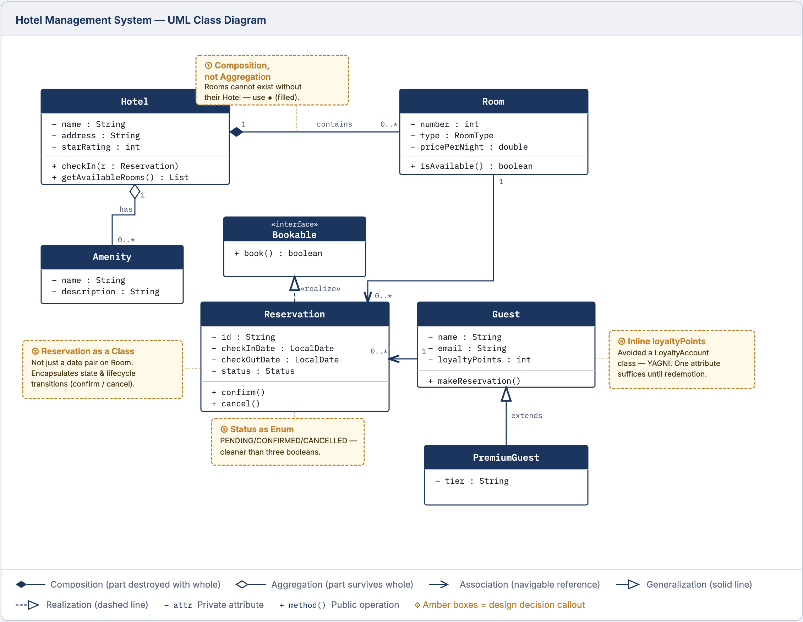
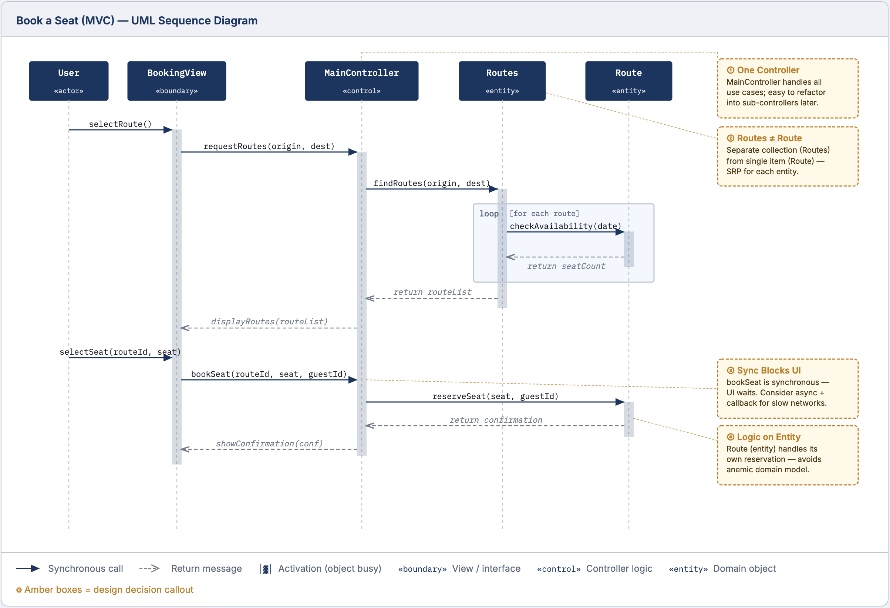

---
hide:
  - navigation
---

# Sprint 2: Project Development & Quality

**Oct 13-Oct 29 &middot; All deliverables due Oct 29, 11:59 PM (with Mid-sprint check-in on Oct 22) &middot; 100 points (10% of course grade)**

Sprint 2 builds on Sprint 1: the goal is to further develop the system with new features, enhacements, defect corrections, etc. The issue backlog, PR workflow, and general expectations carry forward; see [Sprint 1](sprint1.md) for anything not explicitly changed here. This page covers what is **new or different** in Sprint 2.

---

!!! tip "Unfamiliar with a term?"
    Check the [Glossary](glossary.md) for definitions of terms used throughout this page.

---

### Before you begin

- **Identify incomplete issues from Sprint 1.** Review your unfinished Sprint 1 issues before selecting new work (see D1).
- **Read the "Things that must improve" section** section below before starting D2-D5. These issues were observed in Sprint 1 and will be graded strictly.
- Verify your AI log setup is working before starting new agentic sessions.

---

### What is new in Sprint 2

- **UML diagrams and Q&A** (D6): a new individual deliverable
- **Mid-sprint check-in** (D7): a new individual deliverable, **due Oct 22**
- **Technical debt annotation**: a required section in every PR description (D4)
- **Alternatives required** in design decisions (D3)

---

### Things that must improve from Sprint 1

These issues were observed in Sprint 1 and will be graded strictly in Sprint 2. If you are having issues with AI logging, please contact us promptly for support.

**1. AI log completeness.** Every student must have logs committed to the repo. Logs must include full session content: the **prompts you wrote** and the **AI output** in response. Summaries of conversations are **not** AI logs and will not receive full credit. AI output without the prompts that produced it are incomplete logs and will not receive full credit.

**2. AI log linking.** For every issue or PR that involved AI use, post a comment on that issue or PR (note: in this sprint we accept both AI log references in the issue or PR) that links directly to the specific log file. "Directly" means a link that opens the log file itself, not a link to the folder that contains it (e.g., `ai-logs/sprint2/username/`) and not a link to a different issue or PR. Use the format and template from [AI Log Instructions](ai-logs.md) -- you just require copy/pasting the template and changing the fields.

**3. AI log format.** SpecStory format is strongly recommended. Screenshots of the AI interface are not AI logs. Common mistakes to avoid:

- Summaries of conversations instead of full output
- Logs not linked from the issue or PR they document
- AI output pasted without the prompts that produced it

**4. No self-reviews.** A student cannot approve or merge their own PR. Reviewers must post substantive comments, not just click approve. When your PR is ready for review, notify your reviewer promptly in your team's Zulip channel (or email). Aim to turn around reviews within 24 hours of being asked. **Responsive code review is part of being a good team member.**

**5. Design decisions must include alternatives.** Document at least two concrete options you considered and explain why you chose one over the other. "We decided to use X" without alternatives will not earn full credit.

---

### Deliverables

#### D1 - Sprint Backlog

Same process as Sprint 1 ([D1](sprint1.md#d1--sprint-backlog-github-issues)), with one addition:

**Incomplete Sprint 1 issues are a priority.** If you have unfinished Sprint 1 issues, include them in your Sprint 2 backlog before selecting new work. If you decide not to carry over a Sprint 1 issue, document the reason on the issue itself. Acceptable reasons: the issue was closed, made invalid by subsequent changes, or is no longer relevant to the project.

The instructor or TA may also ask for specific issues to be included in the sprint, or add new issues to your team's backlog for you to consider. 

**Scope minimums for Sprint 2** (same as Sprint 1):

| Role | Minimum issues |
|---|---|
| Each CSCI 435 member | at least 2 medium issues (or equivalent story points) |
| Each CSCI 535 (grad) member | at least 2 medium issues + 1 additional small issue (or equivalent story points) |

Create a `Sprint 2` milestone in GitHub and attach all selected issues to it.

**What to provide in D8 (Sprint report):** Link to the Sprint 2 milestone; rationale for backlog decisions; explanation of any Sprint 1 carryovers or skips.

---

#### D2 - Requirements Specification

Same format and requirements as Sprint 1 ([D2](sprint1.md#d2--requirements-specification)). User story format, INVEST criteria, acceptance criteria quality, and peer review are unchanged.

Specs must be written and peer-reviewed before coding begins.

---

#### D3 - Design Decisions

Same format as Sprint 1 ([D3](sprint1.md#d3--design-decisions)), with one required addition:

**Alternatives are required.** Each design decision must name at least two concrete options you considered and explain why you chose one over the other. "We decided to use X" without alternatives will not earn full credit. (See item 5 in "Things that must improve.")

Technical debt is folded into this deliverable via the PR description (see D4). No separate deliverable is needed.

---

#### D4 - Code Changes and Pull Requests

Same workflow as Sprint 1 ([D4](sprint1.md#d4--code-changes-and-pull-requests)), with one required addition to every PR description:

**Technical debt section (required in every PR):**

```markdown
## Tech Debt

**Introduced:** [Describe any shortcuts, workarounds, or design compromises
made in this implementation, and why. If none, write "None."]

**Encountered:** [Describe any pre-existing tech debt you ran into while
working on this issue, and how you handled it. If none, write "None."]
```

Both fields are required. "None." is a valid answer. PRs missing this section will have points deducted.

---

#### D5 - AI Logs

Same requirements as Sprint 1 ([D5](sprint1.md#d5--ai-logs)), with stricter enforcement as described in the "Things that must improve" section above.

**Log storage:** `ai-logs/sprint2/<your-github-username>/`

---

#### D6 - UML Diagrams and Q&A *(new)*

This is a new individual deliverable.

**Before drawing your diagrams, review the tutorials linked below.** They explain UML elements, their meaning, and when to use each type of relationship or notation. Familiarity with the basics will make your diagrams significantly more accurate.

**What to create:** One **class diagram** and one **sequence diagram** for one of your medium issues. The person who resolved the issue creates the diagrams. The diagrams should show  code components and behavior relevant to your issue(s) --- more details below. Below we provide reference diagrams to guide this task.

!!! info "If you resolved multiple small issues equivalent in scope to one medium issue"
    Create diagrams that cover all of those issues together.

!!! info "The Gitea team (Go)"
    Both diagrams are required. Go uses structs and interfaces rather than classes; your class diagram should reflect Go's model (structs, interfaces, embedding). Include a brief note in your submission explaining the mapping from Go constructs to UML notation.

**UML notation:** Inheritance, composition, aggregation, dependency, and association are all valid and expected relationships for class diagrams (see the [Glossary](glossary.md) for definitions). For attributes and methods, show only those relevant to the issue; **you do not need to show every member of every class**.

**Tutorials:**

- Class diagrams: [Lucidchart -- How to Draw a UML Class Diagram](https://www.lucidchart.com/pages/how-to-draw-a-class-diagram-in-UML)
- Sequence diagrams: [Visual Paradigm -- Creating Sequence Diagrams](https://guides.visual-paradigm.com/creating-sequence-diagrams-in-uml-a-comprehensive-tutorial/) &middot; [Gliffy -- UML Sequence Diagram Tutorial](https://www.gliffy.com/resources/how-make-sequence-diagram-uml-diagram-tutorials)

**Tools:** To create the diagrams, you can use any tool of your preference. Examples: [PlantUML](https://plantuml.com/), [Mermaid](https://mermaid.js.org/) (renders directly in GitHub Markdown), [draw.io](https://draw.io/), [Lucidchart](https://lucidchart.com/), [Visual Paradigm](https://visual-paradigm.com/).

---

**What the diagrams should show:**

Each diagram should cover two things:

1. **Relevant existing code** you identified during concept location and impact analysis: the classes, components, or interactions already in the codebase that you needed to understand to implement your solution.
2. **New and modified code** that makes up your solution: the classes, methods, or interactions you added or changed.

Distinguish between existing and new/modified elements (for example, with a legend, color, or a label).

**Annotations are required.** Add brief notes directly on the diagram to explain key design decisions: why a specific relationship exists, why you structured a class a certain way, what an important method call is doing. Annotations are part of the deliverable and will be graded. Diagrams without annotations will not earn full credit. See the amber boxes in the reference diagrams below for examples of annotations.

---

**Reference examples:**

The examples below illustrate the expected style, level of detail, and annotation approach.


*Example class diagram with annotated design decisions.*


*Example sequence diagram with annotated interactions.*

---

**Submission format and location:**

| File | Location |
|---|---|
| `<issue#>-<username>-class.png` (or `.pdf`) | `docs/sprint2/diagrams/` |
| `<issue#>-<username>-sequence.png` (or `.pdf`) | `docs/sprint2/diagrams/` |
| `<issue#>-<username>.md` | `docs/sprint2/diagrams/` -- embeds diagrams and Q&A |

**Expected file structure and Q&A** (copy this template and fill it in):

```markdown
# Issue #<N> -- <issue title>

## Class Diagram


## Sequence Diagram


## Q&A

**Class diagram:**

1. Among all the classes shown in the diagram, which 1--2 are most central to understanding the codebase and solving the issue? Explain what role each one plays.

2. What is the most significant relationship shown in the diagram? Explain what it represents in the system and why it matters for understanding the solution.

3. Looking back at your implementation, is there anything in this design you would change, and why?

**Sequence diagram:**

1. What user action or system event starts the sequence, and what is the expected outcome when it completes successfully?

2. Identify the 2--3 most important steps in the sequence. For each one, describe what is happening and note whether it involves existing code or new/modified code from your solution.

3. What error cases or alternative paths are not shown in the diagram, and why did you leave them out?

**Cross-cutting:**

4. If you used AI to create or check any part of the diagrams, describe what it produced, what you verified against the actual code, and what you had to correct or add. If AI was not used, write "N/A."
```

---

#### D7 - Mid-Sprint Check-in *(new)*

This is a new individual deliverable, graded separately from the team rubric.

**Due: Oct 22, 11:59 PM** (earlier than the sprint deadline).

**Submission:** `docs/sprint2/checkin/<username>.md` in your team's repository.

**Format:** ~150 words per question.

**Questions:**

1. What did you implement so far in the sprint, and what remains?
2. What is one thing you learned about the codebase or about software engineering practice?
3. What is one thing you would do differently?

---

#### D8 - Sprint Report

Same format as Sprint 1 ([D6 in Sprint 1](sprint1.md#d6--sprint-report)).

**Submit to:** `docs/sprint2/report.md` (or `report.pdf`, `report.docx`).

Cover Sprint 2 work only. Include a brief section on Sprint 1 carryovers and what changed. Add entries for UML diagrams (D6) and mid-sprint check-in (D7) to the deliverables summary.

**Deadline:** Oct 29, 11:59 PM.

---

#### D9 - Sprint Release

Same as Sprint 1 ([D7 in Sprint 1](sprint1.md#d7--sprint-release)).

Tag with the `-csci435-s2` suffix. Example: if Sprint 1 was `v2.17.2-csci435-s1`, tag Sprint 2 as `v2.17.2-csci435-s2`.

**Submission:** Link to the GitHub release in D8. Tag pushed by Oct 29, 11:59 PM.

---

#### D10 - Reflection Survey (Individual)

Each team member must complete the Sprint 2 reflection survey individually. The link will be distributed via Blackboard and Zulip toward the end of the sprint.

**Deadline:** Oct 29, 11:59 PM.

---

### Grading

Sprint 2 is worth **100 points** (10% of the course grade). D1, D8, and D9 are graded as a team; all other deliverables are graded individually.

| Deliverable | Points | Notes |
|---|---|---|
| D1 - Sprint Backlog | 10 | Team. Issues selected, estimated, assigned, milestone created; carryover decisions documented |
| D2 - Requirements Specification | 20 | Individual. User story format, INVEST criteria, acceptance criteria quality; peer review evidence |
| D3 - Design Decisions | 5 | Individual. At least one non-trivial decision per issue; rationale with alternatives required |
| D4 - Pull Requests | 20 | Individual. See detail below |
| D5 - AI Logs | 5 | Individual. Logs present, correctly formatted, named, and linked; summary in report |
| D6 - UML Diagrams and Q&A | 15 | Individual. See rubric below |
| D7 - Mid-Sprint Check-in | 5 | Individual. On time and substantive = 5; late or thin = 3; missing = 0 |
| D8 - Sprint Report | 10 | Team. Completeness, specificity, and quality of evidence |
| D9 - Sprint Release | 2 | Team. Tag follows convention; release description summarizes sprint changes |
| D10 - Reflection Survey | 8 | Individual. Required for completion |
| **Total** | **100** | |

**D4 - PR grading detail:**

Same criteria as Sprint 1. The D4 score is the aggregate across all issues, normalized to 20 points. The only change from Sprint 1 is in the description criterion, which now includes the tech debt section.

| Criterion | Points per PR |
|---|---|
| Change correctly implements the acceptance criteria from D2 | 6 |
| Tests written or updated appropriately; test strategy explained in PR | 5 |
| PR description clearly explains what changed, why, and how it was tested; tech debt section present | 4 |
| CI passes (or manual verification documented) | 3 |
| Code reviewed using the rubric; reviewer comment posted on PR | 2 |
| **Total per PR** | **20** |

**D6 - Diagram rubric:**

| Criterion | Points |
|---|---|
| Existing code correctly identified: relevant classes or interactions from the codebase are present and accurate | 2 |
| Solution code correctly represented: new or modified elements accurately reflect the actual implementation | 2 |
| Annotations: key design decisions are explained directly on the diagram | 3 |
| UML notation: correct use of relationships, cardinality, and lifelines (minor errors ok) | 2 |
| Q&A answers: demonstrate understanding beyond what is visible in the diagram | 4 |
| AI use transparency: describes what was generated, what was verified, and what was corrected; or "N/A" | 2 |
| **Total** | **15** |

!!! warning "Minimum bar"
    A team with no merged PRs (D4), no sprint report (D8), or no release (D9) receives a **0 for Sprint 2** regardless of other deliverables.

!!! info "Extra credit"
    A PR submitted to the **real upstream project** and accepted or under active review earns up to **3 bonus points** per PR, at the instructor's discretion.

---

### Submission checklist

Push the following to your team's GitHub repository **by Oct 29, 11:59 PM**:

- Sprint 2 milestone with all selected issues attached and assigned (D1)
- GitHub issue bodies updated with user stories, acceptance criteria, and design decisions with alternatives (D2, D3)
- All PRs merged; each PR description includes the tech debt section; code review rubric posted as a comment on each PR (D4)
- AI logs committed to `ai-logs/sprint2/<github-username>/`, named `YYYY-MM-DD_<tool>_<short-slug>.md`, linked from an issue or PR comment (D5)
- `docs/sprint2/diagrams/<issue#>-<username>-class.png`, `<issue#>-<username>-sequence.png`, and `<issue#>-<username>.md` (D6)
- **`docs/sprint2/checkin/<username>.md` -- due Oct 22, 11:59 PM** (D7)
- `docs/sprint2/report.md` (or `.pdf` or `.docx`) (D8)
- Sprint 2 release tag pushed and GitHub release created (D9)
- D10 reflection survey submitted individually by **Oct 29, 11:59 PM**

---

[Back to Sprints overview](sprints.md)
